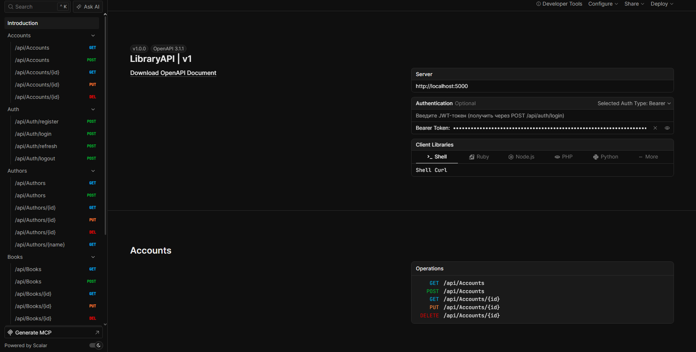
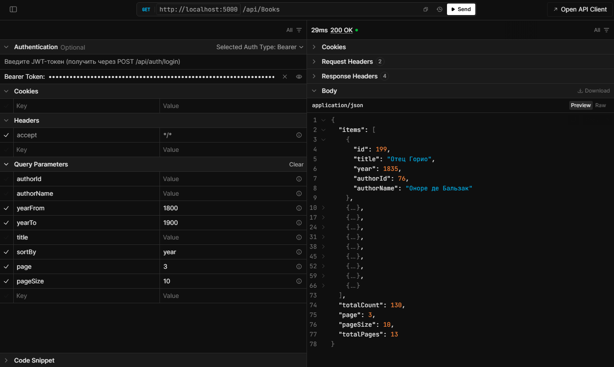
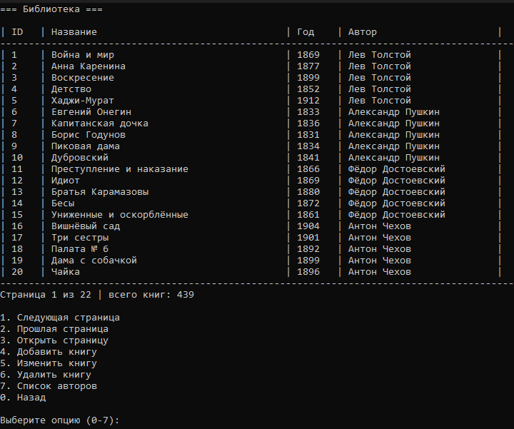
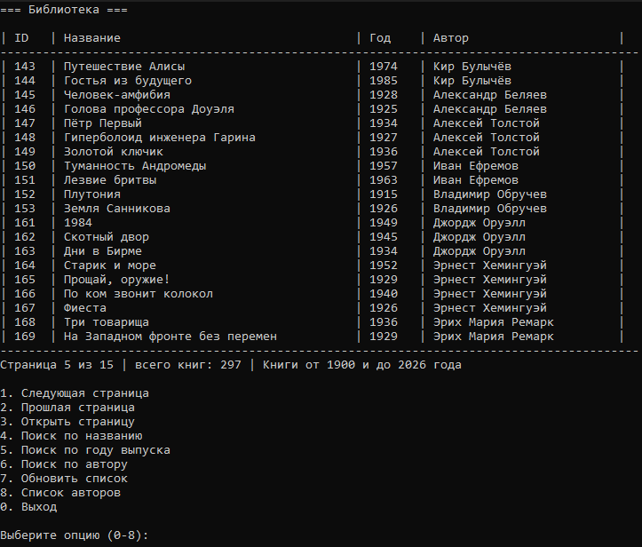

# 📚 LibraryAPI

[](https://github.com/Escape-projects/LibraryAPI/actions/workflows/ci.yml)


REST API для библиотеки: книги и авторы с фильтрацией и пагинацией, аккаунты сотрудников с ролями, JWT-аутентификация с refresh-токенами, кэширование в Redis, 52 юнит-теста и запуск одной командой в Docker.



*Интерактивная документация Scalar: эндпоинты сгруппированы по контроллерам, авторизация по Bearer-токену, запросы выполняются прямо из браузера.*

---

## Что умеет

- **CRUD книг и авторов** — создание, чтение, изменение, удаление; связь книга → автор.
- **Фильтрация, сортировка и пагинация** — по названию, диапазону годов и автору; стабильный порядок выдачи (`ThenBy(id)`), поэтому страницы не пересекаются и записи не дублируются.
- **Роли и права** — `admin` (управление сотрудниками), `librarian` (книги и авторы), `user` (читатель, регистрируется сам).
- **JWT-аутентификация** — access-токен и refresh-токен с ротацией; в базе хранится только SHA-256-хэш refresh-токена.
- **Кэширование в Redis** — списки и отдельные сущности кэшируются по префиксам `books:` / `authors:`, инвалидация по агрегату при любой записи.
- **Устойчивость к отказу кэша** — короткие таймауты, `fail-open` и circuit breaker: недоступный Redis не ломает API, запросы просто идут в базу.
- **Единая обработка ошибок** — кастомные исключения превращаются в корректные HTTP-коды (400/401/403/404/409), stack trace наружу не отдаётся.
- **Структурированное логирование** — Serilog в консоль и файл, разные уровни для 4xx и 5xx, request logging.
- **52 юнит-теста** — сервисы проверяются на реальном EF Core (InMemory) и реальном AutoMapper, мокаются только внешние зависимости.
- **Docker Compose** — API, SQL Server и Redis поднимаются одной командой; миграции и демо-данные применяются автоматически.
- **CI на GitHub Actions** — сборка и прогон тестов на каждый push и pull request.

---

## Стек

| Слой | Технологии |
| :-- | :-- |
| Язык и платформа | C# 14, .NET 10, ASP.NET Core Web API |
| Доступ к данным | EF Core 10 (Code First, миграции), LINQ |
| База данных | Microsoft SQL Server 2022 |
| Кэш | Redis 7, `StackExchange.Redis` |
| Аутентификация | JWT (access + refresh с ротацией), BCrypt |
| Маппинг | AutoMapper |
| Логирование | Serilog (консоль + файл) |
| Документация API | OpenAPI + Scalar UI |
| Тесты | xUnit, Moq, EF Core InMemory |
| Инфраструктура | Docker, Docker Compose, GitHub Actions |

---

## Архитектура

```
┌──────────────────────┐         ┌──────────────────────┐
│ LibraryCorporateApp  │         │   LibraryClientApp   │
│  сотрудники:         │         │  читатель:           │
│  librarian, admin    │         │  роль user           │
└──────────┬───────────┘         └──────────┬───────────┘
           │   HTTP + JWT (access/refresh)  │
           └────────────────┬───────────────┘
                            ▼
              ┌──────────────────────────────┐
              │          LibraryAPI          │
              │  Controllers → Services      │
              │  JWT · Serilog · Scalar      │
              └───────┬──────────────┬───────┘
                      │              │
              EF Core │              │ ICacheService
                      ▼              ▼
              ┌──────────────┐  ┌──────────┐
              │  SQL Server  │  │  Redis   │
              └──────────────┘  └──────────┘
```

SQL Server и Redis работают в отдельных контейнерах; API — единственный слой, который общается с базой и кэшем.

### Структура решения

| Проект | Назначение |
| :-- | :-- |
| `LibraryAPI` | Web API: контроллеры, сервисы, EF Core, кэш, middleware |
| `LibraryAPI.Contracts` | DTO и атрибуты валидации, общие для API и клиентов |
| `LibraryAPI.Tests` | Юнит-тесты сервисов (xUnit + Moq) |
| `LibraryCorporateApp` | Консольный клиент сотрудника: книги, авторы, аккаунты |
| `LibraryClientApp` | Консольный клиент читателя: каталог, авто-вход |

Вынесение DTO в отдельный проект даёт клиентам и API один и тот же контракт — он описан в одном месте.

---

## Эндпоинты

### Аутентификация

| Метод | Путь | Доступ | Описание |
| :-- | :-- | :-- | :-- |
| `POST` | `/api/auth/register` | анонимно | Регистрация читателя (роль `user`) |
| `POST` | `/api/auth/login` | анонимно | Логин, возвращает access- и refresh-токен |
| `POST` | `/api/auth/refresh` | анонимно | Обмен refresh-токена на новую пару (с ротацией) |
| `POST` | `/api/auth/logout` | анонимно | Отзыв refresh-токена |

### Книги

| Метод | Путь | Доступ | Описание |
| :-- | :-- | :-- | :-- |
| `GET` | `/api/books` | авторизован | Список с фильтрами, сортировкой и пагинацией |
| `GET` | `/api/books/{id}` | авторизован | Книга по id |
| `POST` | `/api/books` | `librarian`, `admin` | Создать книгу |
| `PUT` | `/api/books/{id}` | `librarian`, `admin` | Изменить книгу |
| `DELETE` | `/api/books/{id}` | `librarian`, `admin` | Удалить книгу |

### Авторы

| Метод | Путь | Доступ | Описание |
| :-- | :-- | :-- | :-- |
| `GET` | `/api/authors` | авторизован | Список с фильтрами и пагинацией |
| `GET` | `/api/authors/{id:int}` | авторизован | Автор по id |
| `GET` | `/api/authors/{name}` | авторизован | Поиск автора по имени |
| `POST` | `/api/authors` | `librarian`, `admin` | Создать автора |
| `PUT` | `/api/authors/{id}` | `librarian`, `admin` | Изменить автора |
| `DELETE` | `/api/authors/{id}` | `librarian`, `admin` | Удалить автора (409, если у него есть книги) |

### Аккаунты сотрудников

| Метод | Путь | Доступ | Описание |
| :-- | :-- | :-- | :-- |
| `GET` | `/api/accounts` | `admin` | Список сотрудников |
| `GET` | `/api/accounts/{id}` | `admin` | Сотрудник по id |
| `POST` | `/api/accounts` | `admin` | Создать сотрудника |
| `PUT` | `/api/accounts/{id}` | `admin` | Изменить сотрудника |
| `DELETE` | `/api/accounts/{id}` | `admin` | Удалить сотрудника |

`Accounts` управляет **только сотрудниками** (`admin`, `librarian`). Читатели регистрируются через `/api/auth/register` и через этот API не администрируются: администратор библиотеки не управляет учётными записями читателей.

### Параметры выборки

`GET /api/books` и `GET /api/authors` поддерживают:

| Параметр | Значения |
| :-- | :-- |
| `page` | номер страницы, начиная с 1 |
| `pageSize` | размер страницы, 1–100 (по умолчанию 20) |
| `title` / `name` | поиск по подстроке |
| `yearFrom` / `yearTo` | диапазон годов |
| `authorId` / `authorName` | фильтр по автору |
| `sortBy` | `title`, `title_desc`, `year`, `year_desc`, `authorId`, `authorId_desc`, `authorName`, `authorName_desc` |

Пример: фильтр по годам 1800–1900, сортировка по году, третья страница по 10 записей:

```http
GET /api/books?yearFrom=1800&yearTo=1900&sortBy=year&page=3&pageSize=10
```



*Тот же запрос в Scalar: 130 книг после фильтра, 13 страниц, третья страница — книги 1833–1835 годов. Видны и параметры запроса, и метаданные пагинации в ответе.*

---

## Как запустить

### Требования

- .NET 10 SDK
- Docker Desktop (на Windows — с WSL 2)

### Шаг 1. Поднять API и инфраструктуру

```bash
git clone https://github.com/Escape-projects/LibraryAPI.git
cd LibraryAPI
cp .env.example .env
docker compose up -d --build
```

Поднимаются три контейнера. При старте API применяет миграции и, если окружение `Development`, наполняет базу демонстрационными данными: 199 авторов и 439 книг.

Проверить, что всё запустилось:

```bash
docker compose ps
```

Ожидаемый результат:

```text
NAME                IMAGE                                        STATUS                   PORTS
library-api         libraryapi:latest                            Up 2 minutes             0.0.0.0:5000->8080/tcp
library-redis       redis:7-alpine                               Up 2 minutes (healthy)   0.0.0.0:6379->6379/tcp
library-sqlserver   mcr.microsoft.com/mssql/server:2022-latest   Up 2 minutes (healthy)   0.0.0.0:1433->1433/tcp
```

В `.env` лежат только локальные значения: пароль SQL Server и ключ подписи JWT. Файл не попадает в репозиторий, а `.env.example` содержит демонстрационные значения — для реального использования их нужно заменить.

### Шаг 2. Открыть документацию и авторизоваться

1. Откройте **http://localhost:5000/scalar**.
2. Выполните `POST /api/auth/login` с телом:

```json
{ "login": "admin", "password": "admin123" }
```

3. Скопируйте значение `accessToken` из ответа.
4. В левом меню откройте **Introduction**, в блоке **Authentication** выберите **Selected Auth Type → Bearer** — появится поле **Bearer Token**, вставьте в него токен.

После этого защищённые эндпоинты можно вызывать прямо из браузера. Токен подставляется во все запросы глобально; при необходимости его можно указать и в отдельном эндпоинте — там есть такая же вкладка **Authentication**.

Токен живёт 60 минут. Когда истечёт — повторите логин или обменяйте refresh-токен через `POST /api/auth/refresh`.

### Шаг 3. Демонстрационные учётные записи

| Логин | Пароль | Роль | Что доступно |
| :-- | :-- | :-- | :-- |
| `admin` | `admin123` | admin | Всё, включая управление сотрудниками |
| `librarian` | `librarian123` | librarian | Книги и авторы |

Учётки создаются только в окружении `Development` — в production сидер не запускается.

### Шаг 4. Консольные клиенты

Клиенты запускаются локально и по умолчанию обращаются к API из Docker (`http://localhost:5000/`):

```bash
dotnet run --project LibraryCorporateApp   # сотрудник: книги, авторы, аккаунты
dotnet run --project LibraryClientApp      # читатель: каталог, авто-вход
```

Либо откройте `LibraryAPI.slnx` в Visual Studio и запустите нужный проект по F5.

> Если API запущен из Visual Studio, а не в Docker, укажите его адрес в `appsettings.Local.json` — этот файл находится в `.gitignore` и предназначен для локальных переопределений.

Клиенты разделены по ролям и не взаимозаменяемы:

- **`LibraryCorporateApp`** — только для сотрудников (`admin`, `librarian`). Учётная запись с ролью `user` в него не войдёт.
- **`LibraryClientApp`** — только для читателей (роль `user`). Сотрудник (`admin`, `librarian`) в него не войдёт.

#### Клиент для сотрудников

Меню зависит от роли: `librarian` работает с книгами и авторами, `admin` дополнительно управляет аккаунтами сотрудников. Есть пагинация, поиск по названию, году и автору, создание и редактирование записей.



*Каталог под ролью `admin`: страница 1 из 22, всего 439 книг. Внизу — операции, доступные сотруднику.*

#### Клиент для читателя

Вход только для роли `user`. Refresh-токен хранится в `%APPDATA%`, поэтому при следующем запуске выполняется авто-вход без ввода пароля. Доступен просмотр каталога, поиск по названию, году и автору, список авторов.



*Читатель: фильтр по годам 1900–2026 дал 297 книг, открыта пятая страница из пятнадцати.*

### Сбросить данные

```bash
docker compose down -v   # удаляет том с базой
docker compose up -d     # база создаётся заново, сидер наполняет её
```

---

## Кэширование

Кэш вынесен в отдельный слой (`ICacheService`), а не размазан по сервисам.

| Что кэшируется | Ключ | TTL |
| :-- | :-- | :-- |
| Список книг с фильтрами | `books:page=.._size=.._title=..` | 5 мин |
| Книга по id | `books:id={id}` | 10 мин |
| Список авторов с фильтрами | `authors:page=.._size=.._name=..` | 5 мин |
| Автор по id | `authors:id={id}` | 10 мин |
| Автор по имени | `authors:name={name}` | 10 мин |

**Инвалидация по агрегату.** Кэшированные DTO денормализованы: `BookDTO` содержит имя автора, `AuthorDTO` — список книг. Поэтому любая запись сбрасывает оба префикса — `books:` и `authors:`. Префикс работает как тег: всё, что выведено из книг, живёт под одним префиксом, и забыть отдельный ключ невозможно.

**Устойчивость к отказу.** Кэш — оптимизация, а не источник истины:

- короткие таймауты (`ConnectTimeout=1000`, `AsyncTimeout=500`), чтобы недоступный Redis не тормозил запросы;
- `fail-open`: ошибка кэша логируется как warning, запрос уходит в базу;
- circuit breaker: после первой ошибки кэш отключается на 30 секунд, и запросы не платят таймаут повторно.

Как это выглядит в логах — сначала прогрев книги, затем переименование её автора:

```text
[17:56:09 INF] Cache MISS: books:id=4
[17:56:13 INF] Cache HIT: books:id=4
[17:56:45 INF] Cache: removed 1 keys with prefix 'books:'
[17:56:55 INF] Cache MISS: books:id=4
```

Первая строка — первый `GET /api/books/4`, данные из SQL Server. Вторая — повторный запрос, ответ отдан из Redis. Третья — `PUT /api/authors/4` сбросил агрегаты, потому что имя автора входит в `BookDTO`. Четвёртая — следующий `GET` собрал кэш заново.

Логи доступны двумя способами: `docker logs -f library-api` или файл `LibraryAPI/logs/app-*.log`.

---

## Тесты

```bash
dotnet test
```

52 тестовых кейса в 8 классах покрывают сервисный слой:

| Область | Что проверяется |
| :-- | :-- |
| Книги и авторы | CRUD, фильтры, пагинация, 404 при отсутствии, 409 при удалении автора с книгами |
| Аккаунты | Создание и уникальность логина, смена роли, запрет удалить или понизить самого себя |
| Аутентификация | Логин с верным и неверным паролем, отказ заблокированному пользователю |
| Refresh-токены | Генерация, поиск по хэшу, истечение, отзыв |
| JWT | Состав claims, срок жизни, подпись |
| Валидация | Кастомные атрибуты: допустимые роли, диапазон года издания |

Тестам не нужны ни SQL Server, ни Redis: EF Core работает на InMemory-провайдере, внешние зависимости замоканы. Поэтому они одинаково проходят локально и в CI.

---

## Принятые решения (trade-offs)

| Решение | Почему так | Альтернатива |
| :-- | :-- | :-- |
| **SQL Server**, а не PostgreSQL | Цель — enterprise-сегмент, где SQL Server распространён; EF Core позволяет сменить провайдер без переписывания логики | PostgreSQL (в следующем проекте) |
| **Своя реализация fail-open и circuit breaker**, а не Polly | Отказ кэша простой: «не отвечает — не трогаем 30 секунд». Это ~20 строк, которые понятны до конца; в Polly пришлось бы навешивать ту же обвязку | `Polly` / `Microsoft.Extensions.Http.Resilience` (используется в клиентах для retry) |
| **Инвалидация по префиксу**, а не точечная | Ключ — это комбинация фильтров, точечно обновить список нельзя; сброс агрегата дешевле и не оставляет устаревших данных | `HybridCache` с тегами (.NET 9+) |
| **Миграции при старте** | Для демонстрационного проекта важно, что `docker compose up` поднимает всё сразу | Отдельный шаг деплоя в CI/CD |
| **`Development` в контейнере** | Чтобы проверяющий сразу видел Scalar и демо-данные | `Production` и отдельный стенд |
| **AutoMapper** | Быстрый маппинг сущностей в DTO; начиная с 15-й версии требуется лицензия, для демо используется с предупреждением | Mapperly — бесплатный source generator |
| **Консольные клиенты**, а не UI | Фокус проекта — backend: клиенты показывают работу API в связке и не тратят время на фронтенд | Web UI или десктоп на WinForms |

---

## Контакты

- GitHub: [@escape-re](https://github.com/escape-re)
- Telegram: [@escape_137](https://t.me/escape_137)
- Email: Denny2002@list.ru
